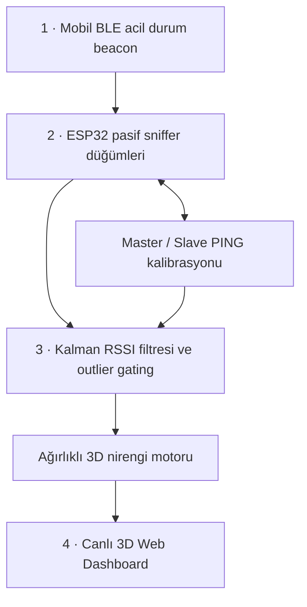

# RescueRadar · 3D Under-Rubble Localization


**Enkaz içi 3D konumlandırma ve çok düğümlü RF radar sistemi** için açık mimari vitrini. Bu depodaki C++ sınıfı sıfırdan yazılmış bağımsız bir eğitim örneğidir. Ticari firmware, gerçek BLE paket yapısı, kalibrasyon verileri, ağırlıklı nirengi motoru ve özel dashboard burada bulunmaz.

## Dört katmanlı mimari



| Katman | Sorumluluk | Açık depodaki kapsam |
| --- | --- | --- |
| Mobil beacon | Bağlantı kurmadan BLE acil durum işaretinin yayınlanması | Mimari açıklama; [Kotlin örnek protokol](https://github.com/Erkan54/Afet-Iletisim-Agi-Android) |
| ESP32 düğümler | Enkaz çevresinde 360° yerleşim, RSSI toplama, master/slave koordinasyonu ve PING ölçümleri | Mimari açıklama |
| Konumlandırma | Kalman, aykırı değer elemesi, ortam kalibrasyonu ve ağırlıklı 3D trilateration | Yalnızca genel skaler RSSI filtresi ve log-mesafe örneği |
| Dashboard | Düğüm durumları, konum kestirimleri ve canlı 3D gösterim | Mimari açıklama |

ESP-NOW / mesh düğüm koordinasyonu ile mobil BLE reklam alımı ayrı iletişim sorumluluklarıdır. PING kalibrasyonu için bu depoda saha parametresi veya özel protokol yayımlanmaz.

## Sinyal işleme örneği

`src/KalmanRSSIFilter.hpp` ve `.cpp` sabit örnekleme aralığı varsayan, tek boyutlu bir Kalman filtresi sunar. Durum RSSI (dBm), belirsizlik ve gürültü varyansları dBm² cinsindendir. İlk geçerli ölçüm durumu başlatır; NaN ve RSSI sınırı dışındaki değerler reddedilir.

Ölçüm öncesi `P_pred = P + Q`, yenilik `y = z - x`, kapı `max(minimumGate, gateSigma * sqrt(P_pred + R))` olarak hesaplanır. Kapının dışındaki ölçüm kestirime katılmaz; tahmin belirsizliği ilerler. Kabul edilen örneklerde skaler Joseph biçimiyle varyans güncellenir. Uzun kesinti veya ani çevre değişiminde çağıran tarafın `reset()` politikası belirlemesi gerekir.

Log-mesafe modeli:

`d = d0 × 10^((RSSI_d0 − RSSI_filtered) / (10 × n))`

`n`, `d0`, referans RSSI ve filtre parametreleri çevreye göre ölçülmelidir. Örnekteki `-59 dBm` ve `n=2.2` sentetik demonstrasyon değerleridir. Çok yollu yayılım, engeller ve anten yönelimi RSSI-mesafe ilişkisini bozar; yumuşatılmış RSSI tek başına gerçek 3D konum doğruluğunu kanıtlamaz. 3D nirengi ayrıca bilinen, uygun geometrili düğüm konumları ve ölçüm belirsizliğinin yönetimini gerektirir.

## Derleme ve test

```sh
cmake -S . -B build -DCMAKE_BUILD_TYPE=Release
cmake --build build
ctest --test-dir build --output-on-failure
./build/rssi_demo
```

Alternatif doğrudan derleme (GCC/Clang):

```sh
g++ -std=c++11 -Wall -Wextra -Werror -pedantic -Isrc src/KalmanRSSIFilter.cpp tests/kalman_test.cpp -o kalman_test
./kalman_test
g++ -std=c++11 -Isrc src/KalmanRSSIFilter.cpp examples/esp32_rssi_smoothing.cpp -o rssi_demo
./rssi_demo
```

Testler aykırı sıçrama elemesini, sentetik gürültüde hata azalmasını, normal sinyal değişimine uyumu, sıfırlamayı ve geçersiz mesafe modeli girdilerini kontrol eder. Demo masaüstünde derlenir; ESP32 BLE callback'ine uyarlama gerektirir. İstisnalar kapalı Arduino derlemelerinde hata yönetimi uyarlanmalıdır. Gerçek cihaz veya enkaz testi içermez.

## Patent başvurusu ve sınıflandırma

**TR 2026/010920** — “Doğal Afetler Sonrasında Enkaz Altında Kalan Canlıların Yerini Elektromanyetik Dalgalar Aracılığıyla Tespit Eden Kablosuz Arama Kurtarma Konumlandırma Sistemi ve Yöntemi”. Numara ve başlık proje sahibi tarafından sağlanmıştır; bu depo tescil belgesi değildir.

Proje için belirtilen Uluslararası Patent Sınıflandırma (IPC) alanları: `H04W 4/90`, `H04W 64/00`, `G01S 5/02`, `G01S 11/06`. Resmî sınıflandırma ve başvuru durumunun kaynağı yetkili sicildir.

[Medyabar · 3D konumlandırma projesi](https://medyabar.com/haber/28394669/genc-muhendis-adayindan-bir-yenilik-daha-depremzedenin-konumu-3-boyutlu-olarak-tespit-edilecek) · [Geliştirici / LinkedIn](https://tr.linkedin.com/in/ahmet-nurullah-erkan-aa5395392)

## Lisans ve kapsam

Bu depoda yayımlanan bağımsız örnek kaynaklar MIT lisanslıdır. Lisans, özel kaynak depolarına veya yayımlanmayan RescueRadar sistemine izin vermez; açık örnek üretim sisteminin uygulanması veya saha performansı iddiası değildir.
